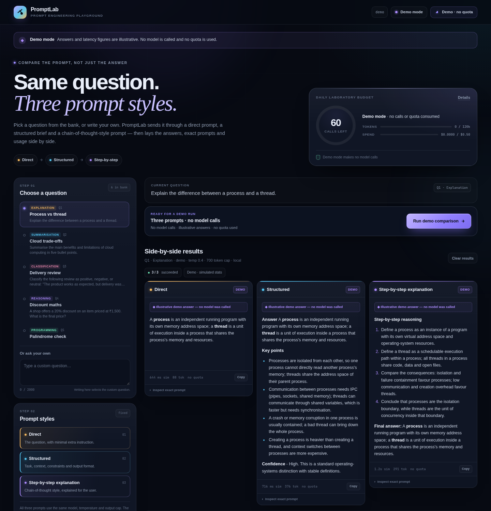

# PromptLab — Prompt Engineering Playground

A small, dependency-free web application that compares **direct**, **structured** and
**step-by-step (chain-of-thought style)** prompting on the same question. It was built
against [`Prompt_Engineering_Playground_SRS.docx`](docs/Prompt_Engineering_Playground_SRS.docx) (SRS-PEP-001).

The app shows the three answers side by side, exposes the exact prompt sent for each
method, and reports latency and token usage. A local Ollama provider is the default;
an OpenAI-compatible endpoint can be configured server-side. A zero-call demo mode is
available for evaluation without any model or API key.



## Quick start

### What you need

| Requirement       | Notes                                                            |
| ----------------- | ---------------------------------------------------------------- |
| Python 3.10+      | Check with `python3 --version`. No packages to install.          |
| Ollama            | Only for live answers. Demo mode works without it.               |
| `llama3.2:latest` | Default model, about 2 GB of disk. Any Ollama model can be used. |
| ~8 GB free RAM    | Comfortable for a 3B model on CPU; more helps on larger models.  |

There is no `pip install`, `npm install` or build step.

### 1. Install Ollama

**Linux**

```bash
curl -fsSL https://ollama.com/install.sh | sh
```

**macOS** — install the app from <https://ollama.com/download>, or:

```bash
brew install ollama
brew services start ollama
```

**Windows** — run the installer from <https://ollama.com/download>. The Ollama app
starts in the background and listens on `127.0.0.1:11434`.

### 2. Start Ollama

The Linux installer usually registers a service. If Ollama is not already running:

```bash
ollama serve
```

Leave that terminal open, or run it as a background service. Verify the API:

```bash
curl -s http://127.0.0.1:11434/api/tags
```

### 3. Pull the model

In a second terminal:

```bash
ollama pull llama3.2:latest
```

The first generation also loads the model into memory, so it can be noticeably slower
than later calls.

```bash
ollama list          # llama3.2:latest should be listed
ollama run llama3.2  # optional: chat with it directly, then /bye
```

If you prefer a different model, pull it and pass it to PromptLab:

```bash
ollama pull mistral
PROMPT_OLLAMA_MODEL=mistral python3 app.py
```

### 4. Start PromptLab

```bash
cd RBT23CB024_PromptEngineeringPlayground
python3 app.py
```

Open <http://127.0.0.1:7860>. The status pill in the header should read **Ollama is
ready**. You can confirm the same thing from the terminal:

```bash
curl -s http://127.0.0.1:7860/api/health | python3 -m json.tool
```

### 5. Run a comparison

Select a question, review the token/spend estimate next to **Compare prompts**, and
press the button. The three panels fill independently, and each one lets you inspect
the exact prompt that was sent.

### Preview without Ollama

To explore the interface without installing a model or making any model call:

```bash
python3 app.py --demo
# or: PROMPT_PROVIDER=demo python3 app.py
```

Demo answers and latency figures are clearly labelled as illustrative. Demo mode does
not consume the daily budget. If the UI was opened with `?demo=1` and the server is in
demo mode, the sample comparison runs automatically.

## What it compares

| Method                       | Prompt construction                                                                      | Purpose                                                 |
| ---------------------------- | ---------------------------------------------------------------------------------------- | ------------------------------------------------------- |
| **Direct**                   | The question plus a short "answer directly" instruction.                                 | Baseline response.                                      |
| **Structured**               | Task, context, constraints and an explicit output format.                                | Test relevance and format consistency.                  |
| **Step-by-step explanation** | Asks for careful working and a concise, user-facing explanation before the final answer. | Test whether explicit problem-solving improves clarity. |

All three variants use the **same model, temperature and maximum output tokens**. The
original question is preserved by every template. The exact system and user prompts are
available in each result panel under **Inspect exact prompt**.

The prompts and question bank are content files, not hard-coded UI strings:

```text
content/questions.json      6 predefined questions covering six task types
content/prompts.json        the three prompt templates
content/demo_answers.json   illustrative demo-mode answers
```

Restart the server after editing a content file.

## Usage limits

The SRS notes that provider rate limits and charges are outside the application's
control. PromptLab adds its own guardrails so a demonstration cannot accidentally burn
through a quota:

| Guardrail                            | Default         | Where to change it         |
| ------------------------------------ | --------------- | -------------------------- |
| Calls per day                        | 60              | `PROMPT_MAX_REQUESTS_DAY`  |
| Tokens per day (prompt + completion) | 120,000         | `PROMPT_MAX_TOKENS_DAY`    |
| Estimated spend per day              | 0.50            | `PROMPT_MAX_COST_DAY`      |
| Output-token cap per call            | 700             | `PROMPT_MAX_OUTPUT_TOKENS` |
| Gap between calls                    | 1,200 ms        | `PROMPT_MIN_INTERVAL_MS`   |
| Prompt length cap                    | 6,000 chars     | `PROMPT_MAX_PROMPT_CHARS`  |
| Comparison size                      | exactly 3 calls | fixed by the three methods |

A comparison is **three sequential calls**. Before spending anything, the backend
computes a worst-case estimate for all three prompts (prompt tokens + output cap) and
rejects the run if it would cross a daily ceiling. The UI shows the estimate next to
the **Compare prompts** button. Calls are paced, the completion length is capped, and a
single comparison cannot run twice at once.

The daily counters are reset at local midnight. They can also be reset from the usage
dialog when `PROMPT_ALLOW_RESET` is enabled (the default).

**No response cache.** Every live result is a fresh model call. This keeps the
comparison honest and satisfies the SRS rule that prompts and responses are not
persisted.

## Privacy and key handling

- Questions and responses are held **in the browser tab's memory only**. There is no
  `localStorage`, `sessionStorage`, cookie, history or export of comparison content.
  Refreshing the page clears the result panels.
- The provider API key is read from the server environment. It is never returned by
  `/api/config`, `/api/health` or any other endpoint, and never reaches browser code.
- The only file the backend persists is `.data/usage.json`, which contains date,
  request/token/cost counters and per-method totals — **no question text, prompts or
  answers**. The server log records method names and timings, not content.
- The default provider is local Ollama, contacted over loopback HTTP. With that default
  setup, prompts do not leave the machine. Remote provider URLs must use HTTPS.
- PromptLab binds to `127.0.0.1` by default and has no accounts or login (per the SRS
  scope). Do not expose it on a public network without a reverse proxy and
  authentication: model calls and the counter reset endpoint would otherwise be open.

## Configuration

### Local Ollama (default)

```bash
PROMPT_PROVIDER=ollama
PROMPT_OLLAMA_URL=http://127.0.0.1:11434
PROMPT_OLLAMA_MODEL=llama3.2:latest
```

### OpenAI-compatible endpoint

```bash
export PROMPT_PROVIDER=openai
export PROMPT_OPENAI_URL=https://api.openai.com/v1
export PROMPT_OPENAI_MODEL=gpt-4o-mini
export PROMPT_OPENAI_KEY=sk-...          # stays on the server
export PROMPT_INPUT_PRICE_PER_M=0.15     # optional, for the spend meter
export PROMPT_OUTPUT_PRICE_PER_M=0.60
python3 app.py
```

Any endpoint that implements `POST /chat/completions` works. The key can also be
provided as `OPENAI_API_KEY`. Remote provider endpoints must use HTTPS; plain HTTP is
allowed only for loopback services (the default local Ollama setup). Health checks for
hosted endpoints are intentionally skipped so that opening the page does not create a
billable request.

### Other settings

| Variable                      | Default              | Meaning                                                 |
| ----------------------------- | -------------------- | ------------------------------------------------------- |
| `PROMPT_PROVIDER`             | `ollama`             | `ollama`, `openai` or `demo`                            |
| `PROMPT_MODEL`                | provider default     | Model override                                          |
| `PROMPT_TEMPERATURE`          | `0.4`                | Shared generation temperature                           |
| `PROMPT_TIMEOUT_SECONDS`      | `240`                | Provider request timeout; first Ollama load can be slow |
| `PROMPT_MAX_COST_DAY`         | `0.50`               | Estimated daily spend ceiling                           |
| `PROMPT_CURRENCY`             | `USD`                | Display currency for configured prices                  |
| `PROMPT_ALLOW_RESET`          | `1`                  | Show the usage reset control                            |
| `PROMPT_DATA_DIR`             | `./.data`            | Counter file location                                   |
| `PROMPT_HOST` / `PROMPT_PORT` | `127.0.0.1` / `7860` | Bind address                                            |

CLI equivalents: `--provider`, `--model`, `--demo`, `--host`, `--port`, `--data-dir`.

## Troubleshooting

| Symptom                                    | Likely cause                         | Fix                                                                                           |
| ------------------------------------------ | ------------------------------------ | --------------------------------------------------------------------------------------------- |
| Status says Ollama is not reachable        | Ollama is not running                | Run `ollama serve`, then check `curl http://127.0.0.1:11434/api/tags`.                        |
| Health says the model is missing           | Model was never pulled               | `ollama pull llama3.2:latest`, or set `PROMPT_OLLAMA_MODEL` to a name from `ollama list`.     |
| First comparison is very slow or times out | Model is loading into memory         | Wait for the first call, or raise `PROMPT_TIMEOUT_SECONDS` (default `240`).                   |
| `Address already in use`                   | Port 7860 is taken                   | Start with `python3 app.py --port 7861`.                                                      |
| Budget blocker before any call             | Daily request/token/cost ceiling hit | Open the usage dialog, wait for the midnight reset, or adjust the limits.                     |
| `0` tokens shown for a response            | Provider did not report usage        | Treated as an estimate (`estimatedTokens`); answers are still valid.                          |
| Ollama runs on another machine             | App blocks plain HTTP off loopback   | Use HTTPS, or tunnel it: `ssh -L 11434:127.0.0.1:11434 user@server` and keep the default URL. |

To let other devices on your LAN use Ollama directly, start it with
`OLLAMA_HOST=0.0.0.0 ollama serve`. PromptLab itself should still bind to `127.0.0.1`
unless you add a reverse proxy and authentication. Because the app requires HTTPS for
non-loopback provider URLs, an SSH tunnel (above) is the simplest way to reach a remote
Ollama over plain HTTP.

Run `ollama ps` to see which model is loaded and how much memory it uses;
`ollama stop llama3.2` unloads it.

## HTTP API

The browser uses the following endpoints. `POST /api/compare` is the single endpoint
that runs the whole comparison.

| Endpoint                | Purpose                                                                                                                                                                                                            |
| ----------------------- | ------------------------------------------------------------------------------------------------------------------------------------------------------------------------------------------------------------------ |
| `POST /api/compare`     | `{ "question": "...", "questionId": "Q1" }` → three result objects, each with `method`, `label`, `ok`, `prompt`, `response` or `error`, latency and token usage. A failure in one method does not hide the others. |
| `POST /api/estimate`    | Pre-flight calls, worst-case token/spend estimate, remaining budget and blockers.                                                                                                                                  |
| `GET /api/config`       | Question bank, strategy metadata, limits, usage and privacy note.                                                                                                                                                  |
| `GET /api/health`       | Provider reachability / model presence. Hosted health is not probed.                                                                                                                                               |
| `GET /api/usage`        | Today's anonymous counters.                                                                                                                                                                                        |
| `POST /api/usage/reset` | `{ "confirm": "reset" }` — reset counters (if enabled).                                                                                                                                                            |

Example:

```bash
curl -s http://127.0.0.1:7860/api/compare \
  -H 'Content-Type: application/json' \
  -d '{"question":"Explain the difference between a process and a thread.","questionId":"Q1"}' \
  | python3 -m json.tool
```

Partial failure response shape:

```json
{
  "ok": false,
  "results": [
    {
      "method": "direct",
      "ok": false,
      "error": { "code": "provider_error", "message": "..." },
      "prompt": {}
    },
    { "method": "structured", "ok": true, "response": "...", "prompt": {} },
    { "method": "cot", "ok": true, "response": "...", "prompt": {} }
  ]
}
```

## SRS traceability

| Requirement                 | Implementation                                                                                                                |
| --------------------------- | ----------------------------------------------------------------------------------------------------------------------------- |
| FR-01 question set          | Six questions in `content/questions.json`, rendered as a selectable list.                                                     |
| FR-02 custom question       | Multiline custom field; typing selects the custom question.                                                                   |
| FR-03 prompt variants       | `content/prompts.json`; direct, structured and step-by-step templates.                                                        |
| FR-04 consistent conditions | `Runtime.compare` uses one model, temperature and output cap for all three calls; echoed in the response.                     |
| FR-05 model requests        | Server-side Ollama / OpenAI-compatible calls; key stays on the server.                                                        |
| FR-06 side-by-side results  | Three labelled panels in a responsive comparison grid.                                                                        |
| FR-07 inspect prompts       | Expandable **Inspect exact prompt** section with system and user messages.                                                    |
| FR-08 loading/errors        | Immediate skeleton panels, elapsed timer, per-method error cards; successful results are preserved when another method fails. |
| FR-09 copy response         | Per-panel **Copy** button with clipboard fallback.                                                                            |
| FR-10 reset                 | **Clear results** removes the current comparison; the next run replaces it.                                                   |
| FR-11 key protection        | Environment-only key; no key in config, health, errors or browser code; redaction of provider error bodies.                   |
| NFR-01 usability            | One question choice, one button and the result panels; custom questions use the same flow.                                    |
| NFR-02 responsiveness       | CSS grid collapses to a single column on tablets/phones.                                                                      |
| NFR-03 security             | Provider calls are server-side; remote provider URLs must use HTTPS; secrets come only from the environment.                  |
| NFR-04 reliability          | Each variant is executed and caught independently.                                                                            |
| NFR-05 maintainability      | Questions, templates and demo content live in `content/`.                                                                     |
| NFR-06 performance          | Skeleton panels, a live elapsed timer and a staged estimate appear immediately; no fixed latency guarantee.                   |
| NFR-07 privacy              | No browser storage; only anonymous counters are persisted server-side.                                                        |

## Tests

```bash
python3 -m unittest discover -s tests -v
```

The suite uses demo mode and a temporary data directory. It covers prompt
construction, the three-method contract, partial failures, budget rejection, token /
cost accounting, API key non-disclosure and the actual HTTP endpoint. No model calls
are made.

## Project layout

```text
app.py                      HTTP server, static files, JSON API
playground.py               prompts, providers, budgets, comparison orchestration
content/                    editable questions, templates and demo answers
static/                     HTML, CSS, JS, favicon
tests/                      unittest suite (no network / no model calls)
docs/                       screenshot
.data/                      anonymous usage counters (created at runtime; not committed)
```

## Notes and limitations

- This is an educational, qualitative comparison. Output is non-deterministic; one run
  does not prove that a prompt style is universally better.
- Token counts come from the provider when reported, otherwise they are explicitly
  marked as estimates (`estimatedTokens`).
- The local provider is not billed. The spend meter is only meaningful when
  `PROMPT_INPUT_PRICE_PER_M` / `PROMPT_OUTPUT_PRICE_PER_M` are configured.
- Step-by-step prompting asks for a concise, user-facing explanation of key steps; it
  does not try to expose a model's private internal reasoning.
- The SRS out-of-scope items (accounts, history, automatic grading, leaderboards,
  RAG, prompt versioning, exports) are intentionally absent.
